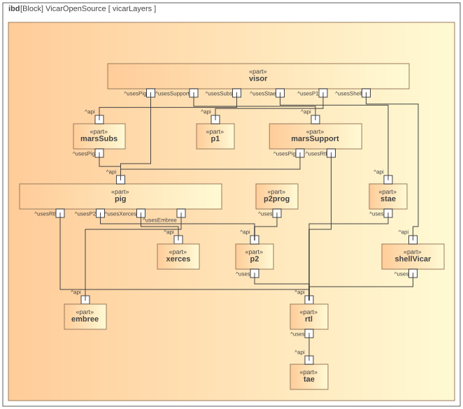
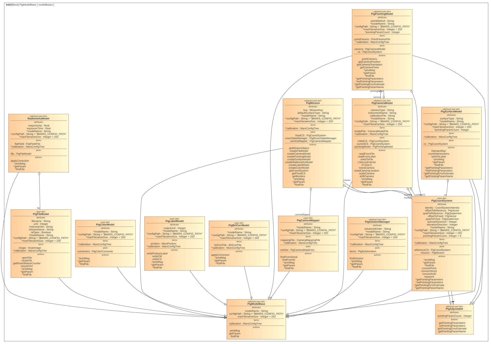
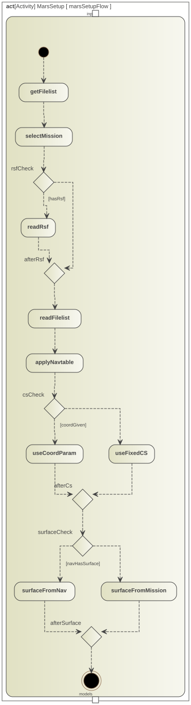
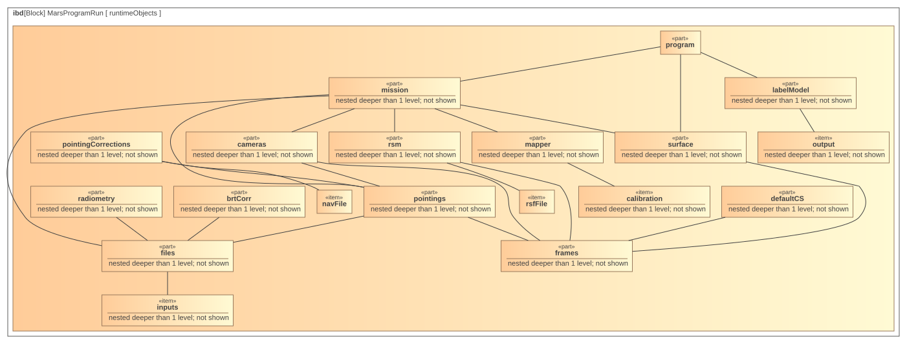

# PIG SysML v2 model

A SysML v2 model of **PIG (Planetary Image Geometry)**, the C++ camera, pointing,
coordinate-system, surface and radiometry library inside VICAR's MARS/VISOR
subsystem. Every VISOR `mars*` program that TIG runs (`marsmap`, `marsnav`,
`marsxyz`, `marsmesh`, ...) builds its geometry on PIG. The model is written
for [OpenSysML](https://github.com/Open-MBEE/OpenSysML), and the diagrams in
[`diagrams/`](diagrams/) are generated from it.

The source of truth is the PIG code in
[NASA-AMMOS/VICAR](https://github.com/NASA-AMMOS/VICAR): `vos/mars/src/sub/pig*`,
`vos/mars/inc`, `vos/mars/src/sub/mars_support`, and the build dependency table
`vos/vicset1_depends.h`. Class names, factory methods and parameters in the
model match the C++ names so you can grep from a diagram to the code.

## Where PIG sits in VICAR

PIG is a layer *on top of* the VICAR core, not under it. `vicset1_depends.h`
declares:

```text
PROD_PIG          -> PROD_VICAR_EXEC (RTL, shell-VICAR, STAE), SS_P2SUB, EXT_XERCES_CXX
PROD_MARS_SURFACE -> PROD_PIG, SS_MARS, SS_CRUMBS, SS_P1SUB, SS_P2SUB, MPI, Xerces, Ceres, SIFT, ...
```

So PIG calls the RTL (`zvopen`, `zvread`, `zladd`, `zlget`, `zvp`, `zvparmd`,
`zvmessage`) and p2 subroutines (`lbl_routines`, `cmod_cahv*`, `PigVector`,
`PigQuaternion`, `mat3`). The 109 VISOR programs and the `mars_support` library
are built on PIG. The rest of VICAR (p2/p3 programs, the display stack) does not
depend on PIG.



## Model files

| File | Package | Contents |
| --- | --- | --- |
| [`01-vicar-context.sysml`](01-vicar-context.sysml) | `VicarContext` | VICAR subsystems, external libraries, link dependencies, TIG deployment |
| [`02-pig-data.sysml`](02-pig-data.sysml) | `PigData` | Geometry types, CS identity, files PIG reads and writes, calibration tree |
| [`03-pig-core.sysml`](03-pig-core.sysml) | `PigCore` | One part def per core PIG class, with inheritance, associations and key methods |
| [`04-pig-missions.sysml`](04-pig-missions.sysml) | `PigMissions` | The 11 mission adapters and the concrete models each one creates |
| [`05-pig-behavior.sysml`](05-pig-behavior.sysml) | `PigBehavior` | `mars_setup`, per-input model creation, camera-model creation, CS resolution, mosaic pixel loop, TIG invocation, camera-model states |
| [`06-pig-runtime.sysml`](06-pig-runtime.sysml) | `PigRuntime` | The PIG objects inside one VISOR process after `mars_setup` |
| [`07-pig-requirements.sysml`](07-pig-requirements.sysml) | `PigRequirements` | Requirements recovered from the code, what satisfies them, which TIG demo verifies them |
| [`09-pig-support.sysml`](09-pig-support.sysml) | `PigSupport` | M2020 EDR/PDS/VICAR-label classes, point-cloud filter shapes, instrument-placement parameters, M98 radiometry, nav XML records, utilities |
| [`10-mars-programs.sysml`](10-mars-programs.sysml) | `MarsPrograms` | Inputs, outputs and parameters of the 20 VISOR programs the TIG demos run; generated from each program's `.pdf` by [`tools/gen-programs.py`](tools/gen-programs.py) |
| [`11-tig-pipelines.sysml`](11-tig-pipelines.sysml) | `TigPipelines` | The five demo scripts as program chains, with the file each program writes and the program that reads it |
| [`12-pig-views.sysml`](12-pig-views.sysml) | `PigViews` | The views rendered into `diagrams/` |

## Diagrams

| View | Diagram | What to review |
| --- | --- | --- |
| V01 | [packages](diagrams/packages.svg) | Model package structure |
| V02 | [vicarLayers](diagrams/vicarLayers.svg) | Which VICAR libraries PIG links to and who links to PIG |
| V04 | [modelBases](diagrams/modelBases.svg) | `PigModelBase`, `PigAdjustable` and every model family, with attributes and methods |
| V05 | [cameraAndPointing](diagrams/cameraAndPointing.svg) | CAHV/CAHVOR/CAHVORE/PSPH, pointing-model families, camera mapping |
| V06 | [coordinateSystems](diagrams/coordinateSystems.svg) | `PigCSReference`, `PigCSDefinition`, `PigCoordSystem`, solution managers |
| V07 | [surfacesAndRadiometry](diagrams/surfacesAndRadiometry.svg) | Surface models; radiometric, brightness and colour correction |
| V08 | [missionFactories](diagrams/missionFactories.svg) | `PigMission` and the mission adapters |
| V09 | [m20Adapter](diagrams/m20Adapter.svg) | What the Mars 2020 adapter creates (other missions follow the same pattern) |
| V10 | [runtimeObjects](diagrams/runtimeObjects.svg) | Object graph of a VISOR program after setup |
| V11 | [tigInvocation](diagrams/tigInvocation.svg) | `tig marsmap ...` from the host CLI to PIG in the container |
| V12 | [marsSetupFlow](diagrams/marsSetupFlow.svg) | `mars_setup()` |
| V13 | [readInputsFlow](diagrams/readInputsFlow.svg) | `mars_read_filelist()`: the order PIG models are built per input |
| V14 | [createCameraFlow](diagrams/createCameraFlow.svg) | `PigMission::createCameraModel`: label model or calibration via camera mapping |
| V15 | [resolveCsFlow](diagrams/resolveCsFlow.svg) | `PigMission::getCoordSystem`: solution lookup and frame chain to Fixed |
| V16 | [mosaicPixelFlow](diagrams/mosaicPixelFlow.svg) | `marsmap` inner loop: ray, surface intersection, back-projection |
| V17 | [cameraLifecycle](diagrams/cameraLifecycle.svg) | Calibrated, pointed, corrected and adjusting camera-model states |
| V18 | [requirements](diagrams/requirements.svg) | Requirements with satisfy and verify links |
| V19 | [coRegistrationPipeline](diagrams/coRegistrationPipeline.svg) | `demo-co-registration.sh`: overlaps, tiepoints, nav table |
| V20 | [panoramaPipeline](diagrams/panoramaPipeline.svg) | `demo-panorama-mosaic.sh`: radiometry, overlap pass, brightness match, mosaic, PNG |
| V21 | [terrainMeshPipeline](diagrams/terrainMeshPipeline.svg) | `demo-mesh-generation-with-xyz.sh`: disparity, XYZ, range filter, OBJ |
| V22 | [surfacePipeline](diagrams/surfacePipeline.svg) | `demo-surface-characteristics.sh`: normals, slope, roughness, placement tilt and goodness |
| V23 | [changeMonitoringPipeline](diagrams/changeMonitoringPipeline.svg) | `demo-change-monitoring.sh`: joint solve, two renders, difference, determinism check |
| V24 | [m2020DataProducts](diagrams/m2020DataProducts.svg) | Mars 2020 EDR, PDS-label and VICAR-label families |
| V25 | [pointFilters](diagrams/pointFilters.svg) | `FilterShape` family read from rover-mask XML |
| V26 | [supportClasses](diagrams/supportClasses.svg) | Instrument parameters, legacy radiometry, nav XML records, utilities |
| V27 | [fileTypes](diagrams/fileTypes.svg) | File types PIG and the programs read and write |
| V28 | [productTypes](diagrams/productTypes.svg) | Image products the programs write |

The flows V12-V16 and V19-V23 carry typed data: solid arrows are item flows
between steps, `=` lines bind a step's pin to the action's own input or output,
dashed arrows are control flow.







## Requirements and traceability

These requirements describe what PIG does today, as recovered from its code and
comments. They are not from a project requirements document. The satisfying
elements are features of `PigRuntime::marsmapRun`, a reference `marsmap` run.

| ID | Requirement | Satisfied by | Verified by |
| --- | --- | --- | --- |
| PIG-01 | Select mission-specific models from the image label | `mission` (`PigMission::getMissionObject`) | V-PANO |
| PIG-02 | Line/sample to ray and point to line/sample for CAHV, CAHVOR, CAHVORE, PSPH | `cameras` | V-PANO, V-MESH |
| PIG-03 | Camera model from label, or from calibration on `CONFIG_PATH` | `mapper` | — |
| PIG-04 | Point each camera from its label articulation, with `POINT_METHOD` overrides | `pointings` | V-PANO |
| PIG-05 | Convert between any two frames by frame name, RMC and solution id | `frames` | V-COREG, V-MESH, V-SURF |
| PIG-06 | CS definitions from RSF/RMC XML and labels, chosen by `SOLUTION_ID` priority | `rsm` | V-SURF |
| PIG-07 | Apply pointing corrections from nav files | `pointingCorrections` | V-COREG |
| PIG-08 | Expose adjustable parameters to solvers | `pointings`, `frames` | V-COREG |
| PIG-09 | Intersect rays with plane, sphere, infinity and mesh surfaces | `surface` | V-PANO |
| PIG-10 | Radiometric and brightness correction | `radiometry`, `brtCorr` | V-PANO |
| PIG-11 | Write geometry into each derived product's label | `labelModel` | V-PANO, V-MESH, V-SURF |
| PIG-12 | Image, label and parameter I/O only through RTL and p2 label routines | `VicarOpenSource::pig` | — |
| PIG-13 | Replaceable message and parameter functions (usable outside TAE) | `VicarOpenSource::pig` | — |
| PIG-14 | Fixed model-construction order in `mars_setup` | `program` | — |
| TIG-01 | Container sets `MARS_CONFIG_PATH` to the calibration | `TigContainerImage` | V-PANO |
| TIG-02 | `tig` runs VISOR programs through `vicar-run` with path translation | `TigCli` | V-PANO |

The verification cases are the TIG demos: V-PANO
[panorama mosaic](../../demos/panorama-mosaic.md), V-COREG
[co-registration](../../demos/co-registration.md), V-MESH
[mesh generation](../../demos/mesh-generation.md), V-SURF
[surface characteristics](../../demos/surface-characteristics.md).

## Validating and regenerating

Install the OpenSysML CLI (`sysml`) from its
[releases](https://github.com/Open-MBEE/OpenSysML/releases) and Graphviz, then:

```bash
docs/sysml/pig/render.sh
# after a change to a program's .pdf in VICAR:
docs/sysml/pig/tools/gen-programs.py /path/to/VICAR docs/sysml/pig/10-mars-programs.sysml
```

The script runs `sysml -validate` on the model and regenerates every SVG in
`diagrams/`. The diagrams were last generated with OpenSysML v0.12.1. To browse
the model interactively, open this directory in an editor with the OpenSysML
language server (`sysml-lsp`), or try `sysml [0-9][0-9]-*.sysml -render PigViews::<view>`.

## Scope and limits

- The core classes are modelled member by member. The mission adapters are
  modelled at the class level (inheritance and what each factory creates), as
  are the support classes in `PigSupport`. `LogFile` and `M2020PixlDpMetaData`
  are only forward-declared in the tree and are not modelled.
- Program I/O covers the 20 `mars*` programs the demos run, not all ~100. In each,
  `CONFIG_PATH`, `RSF`, `SURF_MESH` and `SURF_CSFILE` are grouped in one `setup`
  item; every other file parameter is its own pin. VICAR tools (`f2`, `stretch`,
  `vicario`, `difpic`...) carry only the parameters the demos pass.
- In 4 of the action diagrams Graphviz falls back to straight lines for a few
  edges because the OpenSysML layout puts an invisible anchor on a merge node's
  border.
- Only the methods that callers use are modelled, not every getter.
- The VICAR libraries other than PIG are modelled as black boxes in
  `VicarContext`. To model more of VICAR, add a package per subsystem and
  connect it through the existing `LinkPort`s.
